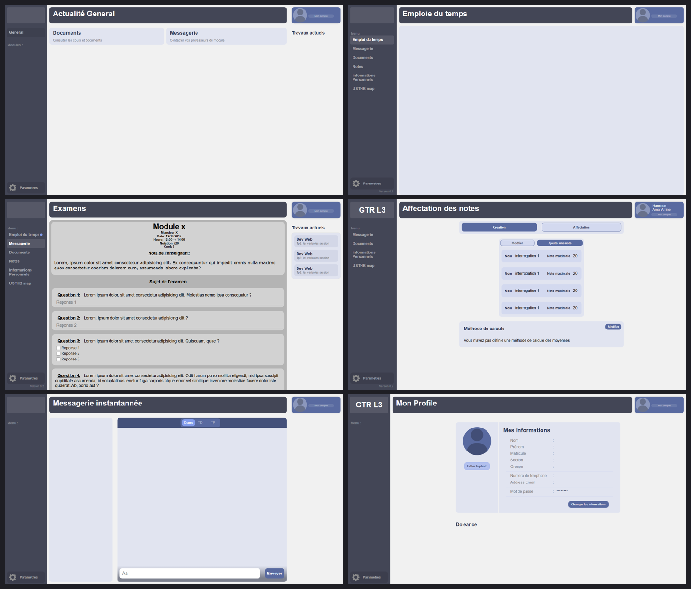
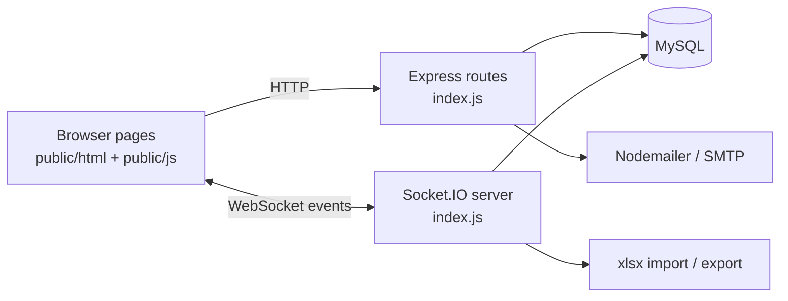

# USTHB Student Portal

A role-based university web portal (students, teachers, administrators) with timetables, grades, exams, course files, messaging and complaints, built with Node.js, Express, Socket.IO and MySQL as an end-of-studies (PFE) project.




> The screenshots are the real HTML/CSS/JS pages from `public/html/`, rendered in headless Chromium **without a database**, so data areas are empty and the page shells show their static placeholder content. The full app needs a MySQL schema that is not part of this repository (see [Notes](#notes)).

## Features

Three roles are supported (`etudiant`, `enseignant`, `admin`), each with their own views:

- **Authentication**: login with bcrypt-hashed passwords (cost 14), cookie-based session tokens with expiry, registration with live password-rule checks, forgot-password flow with an e-mailed verification code
- **Timetables**: per-section weekly timetable; admins can import timetables from Excel files
- **Grades**: teachers define evaluations and calculation methods per module and enter grades; students view their marks
- **Exams**: online exams with free-text and multiple-choice questions, answers stored per student
- **Course posts and files**: teachers publish posts with attachments per module, students comment and download resources
- **Messaging**: real-time chat and direct messages over Socket.IO
- **Complaints** ("doleances"): students submit complaints, admins review and delete them
- **Administration**: dashboard to create sections and modules, create teacher accounts (credentials are generated and e-mailed), import student lists from Excel, generate student account files
- **Profile**: edit personal info and photo, theme preference stored in a cookie

## Tech stack

Node.js, Express 4, Socket.IO 4, MySQL (`mysql` driver), EJS, bcryptjs, cookie-parser, Nodemailer (SMTP), SheetJS (`xlsx`), plain HTML/CSS/JavaScript front end.

## Architecture



Pages are served as static HTML; after login the browser opens a Socket.IO connection and sends its session token, and the server joins the user to rooms based on login and section, then answers events such as `getPosts`, `getNotes`, `getEDT`, `addMessage` or `getDoleances`.

## Getting started

Prerequisites: Node.js 18+ and a MySQL server.

```bash
git clone <this repo> && cd usthb-student-portal
npm install
cp .env.example .env     # fill in DB_* and SMTP_* values
npm start                # http://localhost:3000
```

Configuration is read from environment variables (see `.env.example`): `DB_HOST`, `DB_USER`, `DB_PASSWORD`, `DB_NAME`, `SMTP_USER`, `SMTP_PASS`, `APP_URL`.

## Project structure

```
index.js            Express routes, Socket.IO events, mail and Excel helpers
public/html/        Page templates (login, home, timetable, grades, exams, admin ...)
public/css, js/     Styles and page scripts
public/icons/       Icons
views/              EJS template (Admin_Notes.ejs)
FIN/                Earlier front-end iterations
docs/               Screenshots
```

## Notes

- The project was built by a small team; the git history preserves the original commits of every contributor (about 55 commits, April to June 2023). Credentials that were once hard-coded in early commits were scrubbed from the whole history and replaced by environment variables; the original credentials should be treated as compromised and rotated.
- The MySQL schema is not included in the repository. The code queries these tables: `user`, `etudiant`, `module`, `typemodule`, `section`, `note`, `emploidutemps`, `postes`, `commentaires`, `discussion`, `message`, `doleances`, `examens`, `questions`, `exams_reponse`.
- Roadmap ideas: add a SQL schema / seed script and Docker Compose setup, split `index.js` into route and socket modules, replace string-concatenated cookies for exams with server-side state, add tests.

## Author

Hannoun Amine Amar, Algeria
[LinkedIn](https://www.linkedin.com/in/hannoun-amine/) | hannoun.amine25@gmail.com

Licensed under the MIT License.
