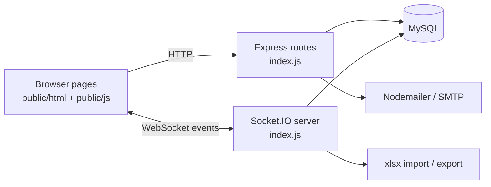

<p align="center">
  
</p>

<p align="center">
  
</p>

<p align="center">
  
  
  
  
  
  
  
</p>

<p align="center">
  
</p>

> The screenshots are the real HTML/CSS/JS pages from `public/html/`, rendered in headless Chromium **without a database**, so data areas are empty and the page shells show their static placeholder content. The full app needs a MySQL schema that is not part of this repository (see [Roadmap](#-roadmap)).

## 🎓 Project context

This is a **Licence Final Studies Project (PFE)**: the end-of-studies project of a Bachelor's (Licence) degree, built in April to June 2023 as a two-person team project.

## 🤝 Team & credits

This project was built as a team effort. Both contributors' commits are preserved in the git history under their own authorship.

| Contributor | GitHub | Role in this repo |
| --- | --- | --- |
| **Hannoun Amine Amar** | [@ORD1STAR](https://github.com/ORD1STAR) | Project author; the majority of the commits (42 of 57 historical commits), covering the server and the main features |
| **Rcym** | [@Rcym](https://github.com/Rcym) | Collaborator; 15 commits, with commit messages about front-end pages, icons, section management, grade entry, timetable fixes and final clean-up |

Thank you to Rcym for the collaboration. Run `git shortlog -sn` to see the contributions per author.

## 📑 Table of contents

- [Project context](#-project-context)
- [Team & credits](#-team--credits)
- [Overview](#-overview)
- [Features](#-features)
- [Screenshots](#-screenshots)
- [Architecture](#-architecture)
- [Tech stack](#-tech-stack)
- [Requirements](#-requirements)
- [Installation and configuration](#-installation-and-configuration)
- [Usage](#-usage)
- [Project structure](#-project-structure)
- [Testing](#-testing)
- [Troubleshooting and FAQ](#-troubleshooting-and-faq)
- [Roadmap](#-roadmap)
- [Contributing](#-contributing)
- [License](#-license)
- [Author](#-author)

## 🌍 Overview

**Problem:** at a university, timetables, grades, exams, course material and student-teacher communication are scattered across tools, and administrators create accounts and sections by hand.

**Solution:** one role-based web portal with three profiles (`etudiant`, `enseignant`, `admin`). Pages are served as static HTML; after login the browser opens a Socket.IO connection and the server answers events (`getPosts`, `getNotes`, `getEDT`, `addMessage`, `getDoleances`, ...) backed by MySQL.

## ✨ Features

- **Authentication**: login with bcrypt-hashed passwords (cost 14), cookie-based session tokens with expiry, registration with live password-rule checks, forgot-password flow with an e-mailed verification code
- **Timetables**: per-section weekly timetable; admins can import timetables from Excel files
- **Grades**: teachers define evaluations and calculation methods per module and enter grades; students view their marks
- **Exams**: online exams with free-text and multiple-choice questions, answers stored per student
- **Course posts and files**: teachers publish posts with attachments per module, students comment and download resources
- **Messaging**: real-time chat and direct messages over Socket.IO
- **Complaints** ("doleances"): students submit complaints, admins review and delete them
- **Administration**: dashboard to create sections and modules, create teacher accounts (credentials are generated and e-mailed), import student lists from Excel, generate student account files
- **Profile**: edit personal info and photo, theme preference stored in a cookie

## 🎬 Screenshots

See the collage above. Individual page renders are in [`docs/`](docs/) (login recovery, main page, timetable, exams, messaging, admin dashboard, admin notes, profile).

## 🏗 Architecture



## 🧰 Tech stack

| Layer | Technology |
| --- | --- |
| Server | Node.js, Express 4, Socket.IO 4 |
| Database | MySQL (`mysql` driver) |
| Views | EJS plus static HTML/CSS/JavaScript |
| Security | bcryptjs, cookie-parser session tokens |
| Mail / files | Nodemailer (SMTP), SheetJS (`xlsx`) |

## 📋 Requirements

| Item | Requirement |
| --- | --- |
| OS | Windows, macOS or Linux |
| Node.js | 18 or newer, with npm (`bcrypt` builds or downloads a native binary during `npm install`) |
| Database | A MySQL server. The schema is **not** included (see Roadmap); the code expects these tables: `user`, `etudiant`, `module`, `typemodule`, `section`, `note`, `emploidutemps`, `postes`, `commentaires`, `discussion`, `message`, `doleances`, `examens`, `questions`, `exams_reponse` |
| Mail | An SMTP account used for verification codes and generated passwords. The transport targets `smtp.office365.com` (see `index.js`) |
| Ports | `3000` (HTTP and Socket.IO, hard-coded in `index.js`), MySQL default `3306` |
| Hardware | Any machine; no GPU |
| Disk | Roughly 150 MB including `node_modules` |

## 🔧 Installation and configuration

```bash
git clone https://github.com/ORD1STAR/usthb-student-portal.git
cd usthb-student-portal
npm install
cp .env.example .env     # Windows: copy .env.example .env
```

Environment variables (`.env`):

| Name | Required | Description | Example placeholder |
| --- | --- | --- | --- |
| `DB_HOST` | No | MySQL host, default `localhost` | `localhost` |
| `DB_USER` | No | MySQL user, default `root` | `YOUR_DB_USER` |
| `DB_PASSWORD` | Yes (in practice) | MySQL password | `YOUR_DB_PASSWORD` |
| `DB_NAME` | No | Database name, default `pfe_gtr3` | `pfe_gtr3` |
| `SMTP_USER` | For e-mails | SMTP account used to send codes and passwords | `YOUR_SMTP_ADDRESS` |
| `SMTP_PASS` | For e-mails | SMTP password or app password | `YOUR_SMTP_PASSWORD` |
| `APP_URL` | No | Public base URL used in e-mails, default `http://localhost:3000` | `http://localhost:3000` |

Credentials that were once hard-coded in early commits were scrubbed and replaced by these variables.

## 🎮 Usage

```bash
npm start                # http://localhost:3000
```

Without a MySQL database that has the expected tables, the pages load but data-backed features will not work. Create admin, teacher and student accounts through the admin dashboard once the schema exists.

## 🗂 Project structure

<details>
<summary>Show tree</summary>

```
index.js            Express routes, Socket.IO events, mail and Excel helpers
public/html/        Page templates (login, home, timetable, grades, exams, admin ...)
public/css, js/     Styles and page scripts
public/icons/       Icons
views/              EJS template (Admin_Notes.ejs)
FIN/                Earlier front-end iterations
docs/               Screenshots
.env.example        Configuration template
USTHB_Plan.pdf      Project plan document
```

</details>

## 🧪 Testing

There is no automated test suite (`test.js` is a scratch file). Manual check: start the server and open the login page.

## 🛠 Troubleshooting and FAQ

<details>
<summary>The server fails to connect to MySQL</summary>

Check `DB_*` in `.env` and that MySQL is running. The schema must exist; it is not provided in this repository.
</details>

<details>
<summary>No verification or account e-mails arrive</summary>

Set `SMTP_USER` and `SMTP_PASS`. The transport in `index.js` is configured for `smtp.office365.com`; change it for another provider.
</details>

<details>
<summary>`npm install` fails on bcrypt</summary>

`bcrypt` needs a prebuilt binary or a C++ toolchain; use Node 18+ or install build tools.
</details>

<details>
<summary>Port 3000 is already in use</summary>

The port is hard-coded in `index.js` (`http.listen(3000, ...)`); stop the other process or edit that line.
</details>

## 🗺 Roadmap

- [ ] Add a SQL schema and seed script plus a Docker Compose setup
- [ ] Split `index.js` into route and socket modules
- [ ] Replace string-concatenated cookies for exams with server-side state
- [ ] Configurable port and SMTP host
- [ ] Automated tests

## 🤝 Contributing

Issues and pull requests are welcome. Never commit `.env` or real student data.

## 📄 License

Released under the [MIT License](LICENSE).

## 👤 Author

<table>
  <tr>
    <td><b>Hannoun Amine Amar</b><br/>AI Engineer / Fullstack Developer, Algeria<br/>Co-author: <a href="https://github.com/Rcym">@Rcym</a></td>
    <td>
      <a href="https://www.linkedin.com/in/hannoun-amine/"></a>
      <a href="https://github.com/ORD1STAR"></a>
      <a href="mailto:hannoun.amine25@gmail.com"></a>
    </td>
  </tr>
</table>

<p align="center">
  
</p>
